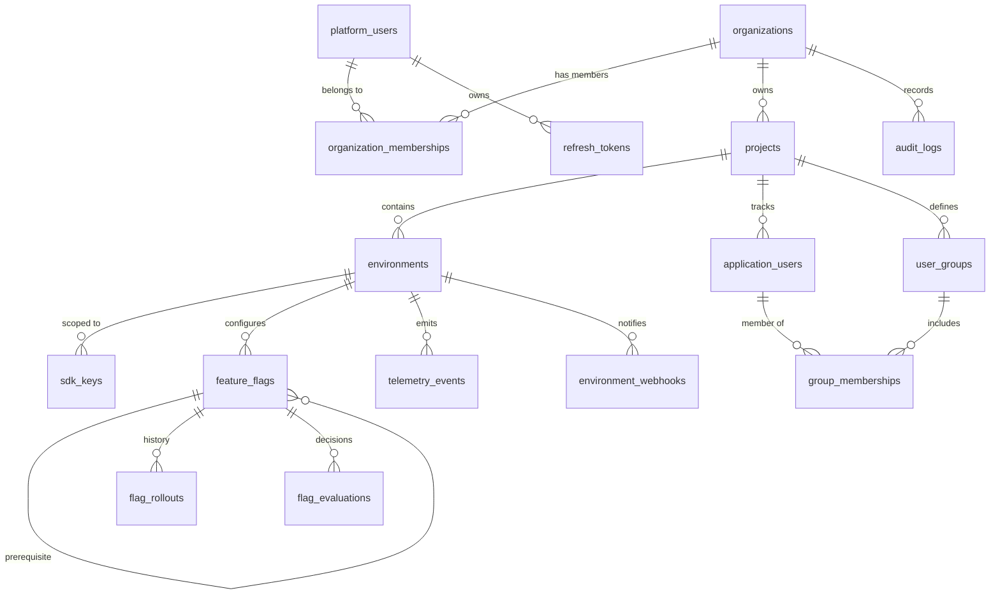

# Database Schema

Primary database: **MySQL 8 / InnoDB** (`utf8mb4_unicode_ci`).

## Entity-Relationship Diagram

## Core Tables

| Table | Purpose |
|---|---|
| `schema_migrations` | Tracks applied SQL migration filenames |
| `organizations` | Tenant/company boundary (`slug`, `plan_tier`) |
| `platform_users` | Dashboard identities and password hashes |
| `organization_memberships` | M:N user-to-org link with `ADMIN`, `DEVELOPER`, `VIEWER` roles |
| `refresh_tokens` | Revocable refresh-token hashes for session security |
| `projects` | Applications/services owned by an organization |
| `environments` | `development`, `staging`, `production` per project with `config_version` |
| `sdk_keys` | Hashed `SERVER` and `CLIENT` SDK keys with rotation `expires_at` |
| `application_users` | End-user context identity and JSON attributes |
| `user_groups` | Reusable targeting cohorts (e.g., `beta_testers`) |
| `group_memberships` | M:N relationship between `user_groups` and `application_users` |
| `feature_flags` | Authoritative flag state, typed JSON values, rollout %, rules, prerequisites, staleness metadata |
| `flag_rollouts` | Historical rollout/targeting snapshots and change reasons |
| `flag_evaluations` | Evaluation decision log with reason code, bucket, and latency |
| `telemetry_events` | Deduplicated `EVALUATION`, `EXPOSURE`, and `CONVERSION` events + SDK metadata |
| `audit_logs` | Organization-wide configuration and security audit trail |
| `environment_webhooks` | Outbound webhook endpoints for environment change notifications |

## Tenant Isolation & Data Integrity Principles

- **Composite foreign keys:** Child tables (`environments`, `sdk_keys`, `application_users`, `user_groups`, `group_memberships`, `feature_flags`, `flag_rollouts`, `flag_evaluations`, `telemetry_events`, `environment_webhooks`) reference composite unique keys `(id, organization_id)` or `(id, project_id, organization_id)` on parent tables. This prevents cross-tenant references at the database layer in addition to backend authorization checks.
- **Check constraints:** `rollout_percentage` is constrained to `0.00–100.00` on both `feature_flags` and `flag_rollouts`.
- **Soft-delete / archiving:** `projects` and `feature_flags` use `archived_at` timestamps so audit and telemetry history remain intact.
- **Separation of concerns:** `PLATFORM_USER` (dashboard operators) and `APPLICATION_USER` (end-users being evaluated) are strictly separate tables. `flag_evaluations` records decisions; `telemetry_events` separates `EVALUATION`, `EXPOSURE`, and `CONVERSION`.

## Reproducible Migrations

See [database/db_README.md](../database/db_README.md) for commands to initialize a fresh database from `database/migrations/` and populate synthetic data from `database/seeds/`.
